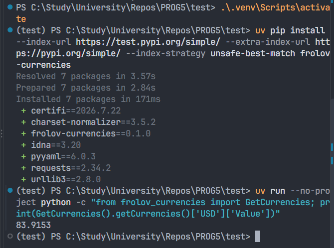

# frolov-currencies

Небольшая библиотека для получения актуальных курсов валют ЦБ РФ и сохранения их в файл в формате JSON, CSV или YAML.

Данные берутся из открытого API [cbr-xml-daily.ru](https://www.cbr-xml-daily.ru/).

## Ссылка

https://test.pypi.org./project/frolov-currencies/

## Установка

Пакет опубликован в тестовом репозитории TestPyPI:

```bash
pip install -i https://test.pypi.org/simple/ --extra-index-url https://pypi.org/simple/ frolov-currencies
```

Требуется Python 3.10 или новее. Зависимости: `requests`, `pyyaml`.

## Использование

Получить курсы в виде словаря и сохранить в JSON:

```python
from frolov_currencies import GetCurrencies

currencies = GetCurrencies()
rates = currencies.getCurrencies()

print(rates["USD"]["Value"])

currencies.createFile("rates.json")
```

Сохранить в CSV или YAML — оберните `GetCurrencies` в нужный конвертер:

```python
from frolov_currencies import GetCurrencies, ConvertToCSV, ConvertToYAML

csv_currencies = ConvertToCSV(GetCurrencies())
rows = csv_currencies.getCurrencies()
csv_currencies.createFile("rates.csv")

yaml_currencies = ConvertToYAML(GetCurrencies())
yaml_currencies.getCurrencies()
yaml_currencies.createFile("rates.yaml")
```

Перед `createFile()` нужно вызвать `getCurrencies()`, иначе будет `ValueError`.

## Классы

| Класс           | Что возвращает `getCurrencies()`   | Формат файла          |
| --------------- | ---------------------------------- | --------------------- |
| `GetCurrencies` | `dict` с курсами по коду валюты    | JSON                  |
| `ConvertToCSV`  | `list[dict]` — по строке на валюту | CSV (разделитель `;`) |
| `ConvertToYAML` | `dict` с курсами по коду валюты    | YAML                  |

Конвертеры реализованы по паттерну «Декоратор» поверх базового класса `Currencies`.

## Ссылки

- Исходный код: https://github.com/bluv4nul/PROG5/tree/main/lab2-pypi

## Лицензия

MIT

## Проверка

Пакет установлен с TestPyPI в чистое виртуальное окружение вне папки проекта. Зависимости (`requests`, `pyyaml`) подтянулись автоматически с основного PyPI, после чего пример из раздела «Использование» вывел текущий курс доллара:


