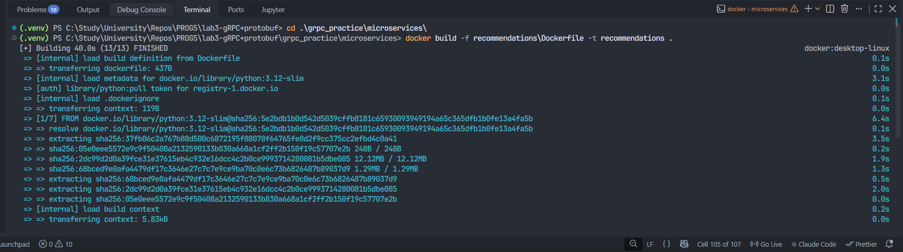
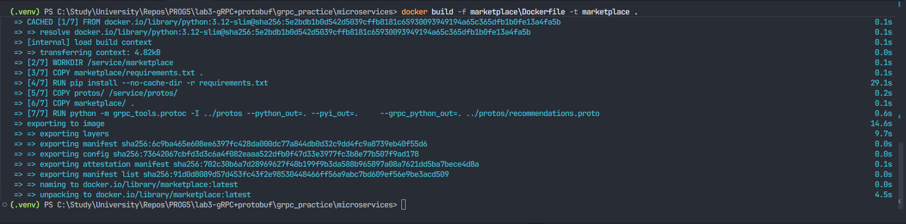
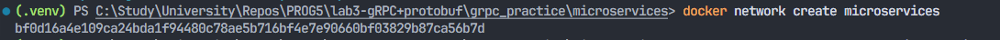
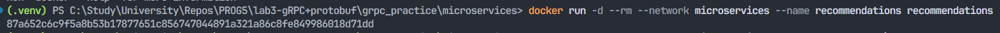
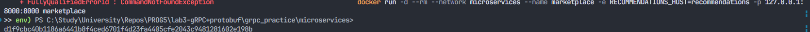
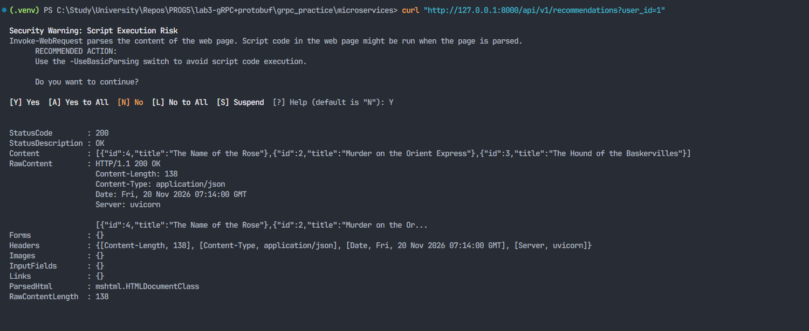
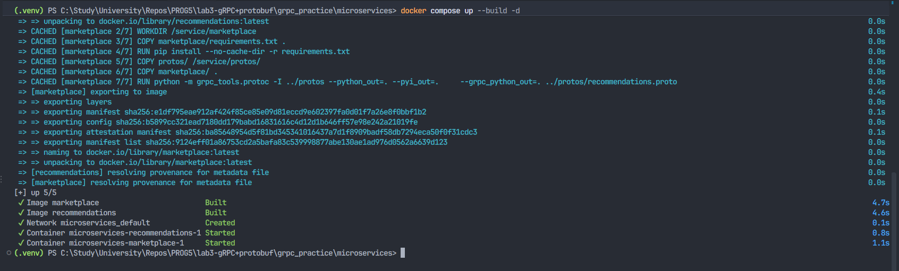
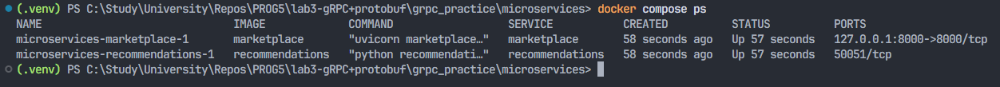
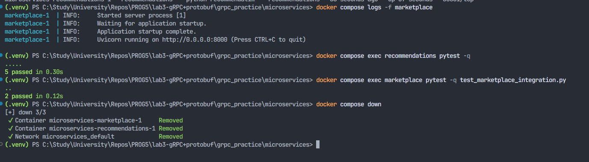

# Отчет о проделанной работе

---

## Docker

#### Запуск контейнеров:

Recomendations:

Marketplace:

#### Создание сети:

Microservices:

Recommendation:

Marketplace:

### Получаем ответ от сервера:

Server Respone:

### Через compose.yaml:

Building with compose:

docker compose ps:

Other:

## Упражнения

1. **SayGoodbye.** В `Greeter` добавлен метод со своими сообщениями запроса и ответа. Клиент получил `Goodbye, you!`.
2. **Размер Demo.** Сообщение `Demo(a=300)` занимает 3 байта. `08` — тег поля № 1 с типом varint. Так как 300 = 2 × 128 + 44, младшая группа даёт `AC` (44 с битом продолжения), старшая — `02`. Сериализация дала `08 AC 02`.
3. **Фильтр рекомендаций.** В запрос добавлено поле `exclude_ids`. Recommendations исключает книги перед выборкой. Marketplace со старой схемой вернул HTTP 200, а новый gRPC-клиент при исключении книги № 5 получил ID `[6, 7, 8]`.
4. **Поток AddBooks.** Клиент отправил книгу через клиентский поток, сервер сохранил её и вернул `Report`. Размер каталога вырос с 4 до 5 книг.
5. **Категория на главной странице.** Marketplace использует параметр `category` в запросе к Recommendations и в заголовке страницы. Тесты проверяют выбор категории и преобразование ошибки gRPC `INVALID_ARGUMENT` в HTTP 400. Все 4 теста прошли.
